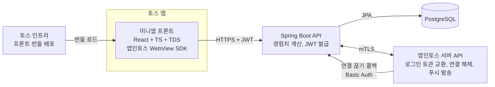

# 펫 플래너 설계 가이드 (Concepts Brief)

- 작성일: 2026-11-02
- 작성자: ParkJongHwan
- 상태: EGM `/egm:egm-draft` 입력용 개념 문서

---

## 1. 개요

펫 플래너는 하루 계획을 세우고 지킬수록 내가 고른 동물이 자라는 앱인토스(토스 미니앱) 서비스다. 일반 할 일 앱과의 차이는 "계획 → 실행 → 회고" 한 바퀴를 동물 성장이라는 보상으로 묶는 데 있다.

이 문서는 Google EGM(Elephant-Goldfish Model) 흐름의 `concepts_brief.md` 역할을 한다. 기능별 상세 설계는 `/egm:egm-draft`로 만들고 `/egm:egm-review`로 검토한 뒤, 구현은 Ponytail 규칙(이해 먼저, 재사용 먼저, 최소한의 코드)으로 진행한다.

### 1.1 문제

- 할 일 앱은 많지만 대부분 "체크하고 끝"이라 며칠 쓰다 그만둔다
- 계획을 세운 것 자체, 지킨 것 자체에 대한 눈에 보이는 보상이 없다
- 하루를 돌아보는 습관(회고)을 만들어 주는 장치가 없다

### 1.2 목표

- 사용자가 매일 아침 계획, 저녁 회고를 하게 만드는 습관 루프를 만든다
- 동물 성장으로 "내가 해냈다"는 감각을 눈에 보이게 한다
- 앱인토스 검수를 통과해 출시한다
- 1인 개발로 6~8주 안에 MVP를 낸다

### 1.3 비목표 (MVP에서 하지 않는 것)

- 친구, 랭킹 등 소셜 기능
- 반복 일정, 캘린더 연동, 알림 시간 개인 설정
- 유료 결제(인앱 결제). 수익은 광고로만 시작한다
- 오프라인 동기화. 네트워크가 있어야 동작한다
- 동물 사망, 퇴화 같은 처벌 장치

---

## 2. 제품 설계

### 2.1 핵심 루프

1. **아침 계획**: 핵심 목표 1개와 할 일 3~7개를 적는다
2. **실행**: 할 일을 체크할 때마다 동물이 즉시 반응한다 (+EXP 표시)
3. **저녁 회고**: 한 줄 회고와 오늘 기분을 남기면 하루가 마감된다
4. **정산**: 오늘 얻은 경험치와 성장 연출을 보여준다. 앱의 하이라이트 화면이다

### 2.2 경험치 규칙

| 행동 | EXP | 조건 |
| --- | --- | --- |
| 아침 계획 세우기 | +10 | 할 일 3개 이상, 계획 마감(정오) 전, 하루 1번 |
| 할 일 1개 완료 | +5 | 마감 이후 추가한 할 일은 +2 |
| 핵심 목표 달성 | +30 | 하루 1번 |
| 저녁 회고 작성 | +10 | 하루 1번 |
| 완료율 80% 이상 | 그날 합계 × 0.2 보너스 | 마감 시 적용 |
| 7일 연속 기록 | +50 | 7일마다 |

- 하루 상한은 100 EXP다. 연속 기록 보너스는 상한에 포함하지 않는다
- 연속 기록은 "회고까지 마감한 날"만 센다
- 체크를 해제하면 그 할 일로 받은 경험치를 회수한다

### 2.3 성장 단계

| 단계 | 코드 | 누적 EXP | 예상 기간 |
| --- | --- | --- | --- |
| 알 | EGG | 0 | 첫날 |
| 아기 | BABY | 100 | 2~3일 |
| 성장기 | JUNIOR | 600 | 약 2주 |
| 어른 | ADULT | 1,800 | 1~2달 |
| 졸업 | GRADUATED | 4,000 | 약 3달 |

- **기분**: 최근 3일 평균 완료율로 정한다. 70% 이상 HAPPY, 40~70% NORMAL, 40% 미만 SAD
- **졸업**: 4,000 EXP에 도달하면 도감에 등록되고 새 알을 고를 수 있다
- **동물 종류**: MVP는 4종(DOG, CAT, PENGUIN, HAMSTER) × 5단계 = 일러스트 20장. 모두 오리지널 그림으로 만든다
- 동물은 죽거나 퇴화하지 않는다. 아쉬움은 기분 표현까지만 준다

### 2.4 화면 구성

| 화면 | 내용 |
| --- | --- |
| 온보딩 | 인트로(서비스 소개) → "시작하기" → 토스 로그인 → 알 고르기 → 이름 짓기 |
| 홈 | 위쪽 절반 동물(단계, 기분, EXP 바), 아래쪽 오늘의 할 일, "아침·저녁 알림 받기" 버튼 |
| 계획 작성 | 핵심 목표, 할 일 입력과 순서 변경 |
| 회고/정산 | 한 줄 회고, 기분 선택, 경험치 정산, 성장 연출 |
| 기록/도감 | 월별 달력 히트맵, 졸업한 동물 목록 |

- 진입하자마자 로그인이나 알림 동의 바텀시트를 띄우지 않는다. 로그인은 인트로에서 사용자가 "시작하기"를 눌렀을 때, 알림 동의는 "알림 받기"를 눌렀을 때만 요청한다
- 앱은 라이트 모드로만 만들고, 핀치 줌은 끈다. 앱인토스 내비게이션 바를 쓰고 자체 뒤로가기 버튼을 겹쳐 두지 않는다

UI는 토스 디자인 시스템(TDS) 컴포넌트를 기본으로 쓴다. 앱인토스 검수와 토스 앱 안에서의 일관성 때문에 외부 디자인 시스템보다 TDS가 우선이다. 문구는 토스 UX 라이팅(해요체)을 따른다.

---

## 3. 시스템 아키텍처와 기술 스택

프론트 번들은 토스 인프라에 올리고, Spring Boot 서버와 PostgreSQL은 직접 배포한다. 앱인토스 정책상 외부 URL 이동과 iframe은 제한되고, 자체 서버와의 HTTPS 통신은 허용된다.



앱인토스 서버와의 통신(로그인, 연결 해제, 푸시)은 반드시 우리 서버를 거친다. 프론트는 `appLogin`이 준 인가 코드와 `referrer`만 넘기고 토큰은 다루지 않는다. 앱인토스 API 응답은 HTTP 200이어도 `resultType`이 `SUCCESS`가 아니면 실패로 처리한다.

| 영역 | 선택 | 이유 |
| --- | --- | --- |
| 프론트 | Vite + React + TypeScript | 앱인토스 WebView 공식 구성, React 학습과 연결 |
| UI | TDS(토스 디자인 시스템) | 검수 기준, 토스 앱과 일관성 |
| 백엔드 | Spring Boot 3, Java 21 | 이미 다뤄본 스택 |
| DB | PostgreSQL 16 | `timestamptz`, 부분 인덱스, `generate_series` |
| 마이그레이션 | Flyway | 스키마 변경 이력 관리 |
| 테스트 | JUnit 5, Testcontainers | 실제 PostgreSQL로 통합 테스트 |
| 서버 배포 | Docker 이미지 1개 + 관리형 PostgreSQL | 1인 운영에 맞는 최소 구성 |

---

## 4. 데이터 설계 (PostgreSQL)

테이블은 5개다. 경험치는 `exp_logs`에 이벤트로 쌓고, `pets.total_exp`는 그 합계를 캐시해 둔 값이다.

```sql
CREATE TABLE users (
  id              BIGINT GENERATED ALWAYS AS IDENTITY PRIMARY KEY,
  toss_user_key   VARCHAR(100) NOT NULL UNIQUE,
  nickname        VARCHAR(30),
  push_agreed_at  TIMESTAMPTZ,            -- 알림 동의 시각, null이면 푸시를 보내지 않음
  created_at      TIMESTAMPTZ NOT NULL DEFAULT now()
);

CREATE TABLE pets (
  id            BIGINT GENERATED ALWAYS AS IDENTITY PRIMARY KEY,
  user_id       BIGINT NOT NULL REFERENCES users(id) ON DELETE CASCADE,
  species       VARCHAR(20) NOT NULL,   -- DOG, CAT, PENGUIN, HAMSTER
  name          VARCHAR(20) NOT NULL,
  stage         VARCHAR(20) NOT NULL DEFAULT 'EGG',
  total_exp     INT NOT NULL DEFAULT 0,
  is_active     BOOLEAN NOT NULL DEFAULT true,
  graduated_at  TIMESTAMPTZ,
  created_at    TIMESTAMPTZ NOT NULL DEFAULT now()
);
-- 유저당 활성 펫은 1마리만
CREATE UNIQUE INDEX uq_active_pet ON pets(user_id) WHERE is_active;

CREATE TABLE daily_plans (
  id               BIGINT GENERATED ALWAYS AS IDENTITY PRIMARY KEY,
  user_id          BIGINT NOT NULL REFERENCES users(id) ON DELETE CASCADE,
  plan_date        DATE NOT NULL,
  main_goal        VARCHAR(100),
  planned_at       TIMESTAMPTZ,
  reflection       VARCHAR(200),
  feeling          VARCHAR(10),           -- GOOD, SOSO, BAD
  closed_at        TIMESTAMPTZ,
  auto_closed      BOOLEAN NOT NULL DEFAULT false,
  completion_rate  SMALLINT,              -- 0~100, 마감 시 확정
  UNIQUE (user_id, plan_date)
);

CREATE TABLE tasks (
  id             BIGINT GENERATED ALWAYS AS IDENTITY PRIMARY KEY,
  plan_id        BIGINT NOT NULL REFERENCES daily_plans(id) ON DELETE CASCADE,
  title          VARCHAR(100) NOT NULL,
  is_main        BOOLEAN NOT NULL DEFAULT false,
  is_late_added  BOOLEAN NOT NULL DEFAULT false,
  done           BOOLEAN NOT NULL DEFAULT false,
  done_at        TIMESTAMPTZ,
  sort_order     SMALLINT NOT NULL DEFAULT 0
);

CREATE TABLE exp_logs (
  id          BIGINT GENERATED ALWAYS AS IDENTITY PRIMARY KEY,
  pet_id      BIGINT NOT NULL REFERENCES pets(id) ON DELETE CASCADE,
  plan_date   DATE NOT NULL,
  amount      INT NOT NULL,
  reason      VARCHAR(30) NOT NULL,     -- PLAN, TASK, MAIN_GOAL, REFLECTION, BONUS_RATE, STREAK
  ref_id      BIGINT NOT NULL,          -- task id 또는 plan id
  created_at  TIMESTAMPTZ NOT NULL DEFAULT now(),
  UNIQUE (pet_id, reason, ref_id)
);
CREATE INDEX ix_exp_logs_pet_date ON exp_logs(pet_id, plan_date);
```

- `UNIQUE (pet_id, reason, ref_id)`가 중복 지급을 DB 수준에서 막는다
- 하루 상한 계산은 `exp_logs`에서 `plan_date` 기준 합계로 한다 (STREAK 제외)
- 스키마 변경은 Flyway 마이그레이션 파일로만 한다. 운영 설정은 `ddl-auto: validate`
- `user`는 PostgreSQL 예약어이므로 테이블 이름은 `users`로 한다
- 하루 경계는 서울 04:00 고정이라 사용자별 경계 컬럼을 두지 않는다
- `toss_user_key`에는 `login-me`가 준 `userKey`(int64)를 문자열로 저장한다. 토스 AccessToken·RefreshToken은 로그인 처리 중에만 쓰고 DB에 저장하지 않는다

---

## 5. API 설계

REST + JSON이며 모든 경로는 `/api/v1` 아래에 둔다. 로그인 이후 요청은 `Authorization: Bearer <JWT>` 헤더로 인증한다.

| 메서드 | 경로 | 설명 | 응답 핵심 |
| --- | --- | --- | --- |
| POST | /auth/toss | `{authorizationCode, referrer}`로 로그인, 자체 JWT 발급 | accessToken, hasActivePet |
| DELETE | /auth/me | 회원 탈퇴: 토스 연결 해제(`remove-by-user-key`) 후 모든 데이터 삭제 | 204 |
| POST | /auth/toss/unlink | 토스 앱에서 연결을 끊었을 때 앱인토스가 부르는 콜백. JWT 대신 Basic Auth로 인증하고, 해당 `userKey`의 데이터를 모두 삭제 | 200 |
| PUT | /me/push-agreement | 알림 동의 결과(`newAgreement`, `alreadyAgreed`)를 기록 | 204 |
| POST | /pets | 알 선택 (활성 펫이 없을 때만) | pet |
| GET | /home | 오늘 계획, 할 일, 펫 상태를 한 번에 | plan, tasks, pet |
| PUT | /plans/today | 핵심 목표 저장, 계획 확정 | plan, gainedExp |
| POST | /plans/today/tasks | 할 일 추가 | task |
| PATCH | /tasks/{id} | 제목 수정, 순서 변경 | task |
| DELETE | /tasks/{id} | 할 일 삭제 (완료 전만) | 204 |
| POST | /tasks/{id}/toggle | 완료 체크/해제 | task, gainedExp, pet |
| POST | /plans/today/close | 회고 저장과 하루 마감 | settlement |
| GET | /plans?month=2026-11 | 달력 히트맵 | [{date, completionRate}] |
| GET | /pets/collection | 도감 | [pet] |

### 정산 응답 예시

```json
{
  "settlement": {
    "date": "2026-11-02",
    "completionRate": 83,
    "items": [
      {"reason": "PLAN", "amount": 10},
      {"reason": "TASK", "amount": 25},
      {"reason": "MAIN_GOAL", "amount": 30},
      {"reason": "REFLECTION", "amount": 10},
      {"reason": "BONUS_RATE", "amount": 15}
    ],
    "totalGained": 90,
    "pet": {"stage": "BABY", "totalExp": 412, "nextStageExp": 600, "stageChanged": false}
  }
}
```

### 에러 형식

```json
{"code": "PLAN_ALREADY_CLOSED", "message": "이미 마감된 하루예요"}
```

화면에 보여줄 문구는 서버가 내려준다. 주요 에러 코드:

| 코드 | HTTP | 상황 |
| --- | --- | --- |
| UNAUTHORIZED | 401 | 토큰 없음, 만료 |
| NOT_FOUND | 404 | 없거나 남의 리소스 |
| PLAN_ALREADY_CLOSED | 409 | 마감된 날 수정 시도 |
| ACTIVE_PET_EXISTS | 409 | 활성 펫이 있는데 알 선택 |
| TASK_LIMIT_EXCEEDED | 400 | 하루 할 일 20개 초과 |
| DONE_TASK_NOT_DELETABLE | 400 | 완료한 할 일 삭제 시도 |

---

## 6. 핵심 로직

경험치 계산은 전부 서버의 `ExpService` 한 곳에서만 한다. 클라이언트는 계산하지 않고 응답에 담긴 결과만 그린다.

### 6.1 하루의 경계

- 사용자의 "오늘"은 서울 시간 새벽 4시에 바뀐다
- 계산식: `planDate = ZonedDateTime.now(clock, Asia/Seoul).minusHours(4).toLocalDate()`
- 이 계산은 `DayClock` 클래스 하나에 모으고, 테스트에서는 `java.time.Clock`을 주입해 고정한다
- 계획 마감 시각은 그날 12:00(서울)이다. 이후 추가한 할 일은 `is_late_added = true`
- 마감하지 않고 지난 날은 매일 04:05 배치가 자동 마감한다. 자동 마감은 회고 보너스가 없고 연속 기록도 끊긴다

### 6.2 경험치 지급 흐름 (할 일 체크)

1. 할 일과 계획을 조회하고, 계획이 오늘 것이며 마감 전인지 확인한다
2. 펫 행을 `SELECT ... FOR UPDATE`로 잠근다
3. `done`을 뒤집는다
4. 체크면: 오늘 합계를 구하고 `min(지급액, 100 - 오늘 합계)`만큼 `exp_logs`에 넣는다. 0이면 넣지 않는다
5. 해제면: 해당 `(TASK, taskId)` 로그를 지운다
6. `pets.total_exp`를 갱신하고 `PetStage.of(totalExp)`로 단계를 다시 계산한다
7. 1~6을 한 트랜잭션으로 묶는다

### 6.3 하루 마감 흐름

1. 회고와 기분을 저장한다
2. 완료율 = 완료한 할 일 수 / 전체 할 일 수 × 100 (할 일 0개면 0)
3. 핵심 목표 할 일이 완료 상태면 MAIN_GOAL 지급
4. 회고가 있으면 REFLECTION 지급
5. 완료율 80% 이상이면 그날 합계 × 0.2를 BONUS_RATE로 지급 (상한 적용)
6. 연속 기록이 7의 배수가 되면 STREAK 지급 (상한 미적용)
7. `closed_at`, `completion_rate`를 확정하고 정산 응답을 만든다

### 6.4 동시성

- 같은 할 일을 빠르게 두 번 누르는 경우는 `exp_logs` UNIQUE 제약이 막는다. 제약 위반은 "이미 지급됨"으로 처리하고 에러로 내보내지 않는다
- 하루 상한 계산이 동시에 일어나는 경우는 펫 행 잠금(`@Lock(PESSIMISTIC_WRITE)`)으로 막는다

### 6.5 단계 계산

단계는 저장값이지만 항상 `total_exp`로부터 다시 계산할 수 있어야 한다. `PetStage.of(totalExp)` 순수 함수 하나로 만들고, 경계값(99/100, 599/600, 1799/1800, 3999/4000)을 단위 테스트로 고정한다.

---

## 7. 앱인토스 연동, 수익화, 검수

앱인토스 기능은 로그인, 푸시, 공유, 광고 네 가지만 쓴다. 함수와 API 이름은 앱인토스 공식 문서(2026-11-02 확인) 기준이다. 서버 API의 Base URL은 `https://apps-in-toss-api.toss.im`이고 모두 mTLS로 호출한다.

| 기능 | 쓰는 곳 | 프론트 SDK (`@apps-in-toss/web-framework`) | 서버 API (`/api-partner/v1/apps-in-toss` 아래) |
| --- | --- | --- | --- |
| 토스 로그인 | 온보딩 | `appLogin()` → `{authorizationCode, referrer}` | `POST /user/oauth2/generate-token` → `GET /user/oauth2/login-me`로 `userKey` 확인 |
| 로그인 연결 해제 | 회원 탈퇴 | 없음 | `POST /user/oauth2/access/remove-by-user-key` |
| 연결 끊기 콜백 | 토스 앱에서 연결 끊기·약관 철회·토스 탈퇴 | 없음 | 앱인토스 → 우리 `POST /api/v1/auth/toss/unlink` (`userKey`, `referrer`: `UNLINK`·`WITHDRAWAL_TERMS`·`WITHDRAWAL_TOSS`) |
| 알림 동의 | 홈 "알림 받기" 버튼 | `requestNotificationAgreement({options: {templateCode}, onEvent, onError})` | 없음 (결과는 우리 `PUT /me/push-agreement`로 기록) |
| 푸시 | 아침 계획 알림, 저녁 회고 알림 | 없음 | `POST /messenger/send-message` (헤더 `x-toss-user-key`, 단건) |
| 공유하기 | 단계 진화, 졸업 순간 | `getTossShareLink('intoss://pet-planner/...', ogImageUrl)` → `share({message})` | 없음 |
| 보상형 광고 | 꾸미기 아이템 받기 (MVP 이후) | `loadFullScreenAd` → `loaded` 이벤트 후 `showFullScreenAd` | 없음 |
| 배너 광고 | 기록 화면 하단 | `TossAds.initialize`(앱에서 1번) → `TossAds.attachBanner(adGroupId, el, {theme: 'light'})` → `destroy()` | 없음 |

- 토스 AccessToken은 1시간 유효하다. 로그인할 때 `login-me`만 부르고 버리므로 refresh-token API는 쓰지 않는다
- 서비스가 직접 연결을 해제하면 콜백이 오지 않는다. 그래서 탈퇴할 때 `remove-by-user-key`를 호출하고 우리 데이터도 직접 지운다
- `intoss://` 링크는 정식 출시 뒤에만 열린다. 출시 전에는 `intoss-private://...?_deploymentId=` 링크로 테스트한다. 공유 기능에 `intoss-private://`를 넣어 출시하지 않는다

### 7.1 푸시 원칙

앱인토스 푸시는 기능성 메시지로만 보낼 수 있고, 서비스 이용 유도나 리텐션 목적의 문구는 반려된다. 그래서 "사용자가 신청한 정해진 시간 알림"(출석 알림과 같은 유형)으로 설계한다.

- 사용자가 홈에서 "아침·저녁 알림 받기"를 누르면 알림 동의문을 띄운다. 동의한 사용자(`push_agreed_at` 있음)에게만 보낸다
- 콘솔에서 먼저 할 일: 알림 동의문 등록 → 기능성 캠페인 2개(아침, 저녁) 생성 → 문구 검수 승인. 발송 코드는 `pet-planner-`로 시작한다
- 하루 최대 2번이다. 아침 8시에는 오늘 계획이 없는 사용자에게만 보내고, 저녁 9시에는 아직 마감하지 않은 사용자에게만 보낸다
- 21:00부터 다음 날 08:00 전까지는 야간이라 대량 발송(`send-bulk-message`)이 보류된다. 그래서 두 알림 모두 단건 `send-message`로 사용자마다 보낸다 (사용자당 분당 10회 제한)
- 문구 형식: 제목은 7자 이내 명사형, 본문은 25자 이내 '~요.' 문장이다. 예: 제목 "계획 알림", 본문 "오늘 계획을 세울 시간이에요." / 제목 "회고 알림", 본문 "오늘 하루를 돌아볼 시간이에요."
- 기다림, 아쉬움, 동물의 감정으로 행동을 재촉하는 문구는 쓰지 않는다 ("뭉치가 기다려요" 금지)
- 알림을 끄는 방법(토스 앱 → 전체 → 설정 → 알림 → 서비스별 알림)을 알림 받기 버튼 옆에 안내한다

### 7.2 수익화 원칙

- 광고 보상은 꾸미기(모자, 배경)로만 준다. 받는 아이템은 미리 정해 두고 무작위 뽑기로 주지 않는다 (사행성 정책)
- 보상은 `userEarnedReward` 이벤트가 왔을 때만 준다. `dismissed`만으로는 주지 않는다
- 경험치는 광고나 돈으로 살 수 없다. "노력으로 키운다"는 컨셉을 지킨다
- 꾸미기와 보상을 현금이나 포인트로 바꾸는 기능은 만들지 않는다
- 배너는 스크롤되는 기록 화면의 맨 끝에 한 개만 둔다. 달력 셀이나 버튼 바로 옆에 붙이지 않고, 너비 100%·높이 102px로 둔다
- 광고 API는 쓰기 전에 `isSupported()`로 확인하고, 지원하지 않으면 광고 자리 없이 화면을 그린다 (배너는 토스 앱 5.241.0 이상에서만 동작)
- 꾸미기 데이터는 MVP 이후 `pet_items` 테이블로 추가한다

### 7.3 검수 체크리스트

- [ ] TDS 컴포넌트와 토스 UX 라이팅(해요체) 사용
- [ ] 광고를 강요하거나 속이는 다크패턴 없음 ("광고 안 보면 동물이 슬퍼해요" 금지)
- [ ] 외부 URL 이동, iframe 사용 없음. 프론트 번들은 토스 인프라에 배포
- [ ] 이용약관, 개인정보처리방침, 고객센터 링크를 콘솔에 등록
- [ ] 회원 탈퇴 시 데이터 삭제 동작
- [ ] 토스 앱에서 연결을 끊으면 데이터가 삭제되고, 다시 들어오면 약관 화면이 다시 보임
- [ ] 로그인 전 인트로에서 서비스 설명 제공, 진입 직후 바텀시트 자동 노출 없음
- [ ] 토스 로그인 외 다른 로그인 방식 없음
- [ ] 라이트 모드, 핀치 줌 꺼짐, 앱인토스 내비게이션 바 사용, 최초 화면에서 뒤로가기 시 종료
- [ ] 알림은 동의한 사용자에게만 발송, 문구 검수 승인 완료
- [ ] 공유 링크가 `intoss://` 스킴
- [ ] 개발 중에는 테스트 광고 ID(`ait-ad-test-rewarded-id`, `ait-ad-test-banner-id`)만 사용
- [ ] 샌드박스 앱과 토스 앱 QR 테스트 완료 (광고는 샌드박스에서 동작하지 않으므로 QR로만 확인)

---

## 8. 교차 관심사

### 8.1 보안

- 앱인토스 mTLS 인증서와 키는 Git에 올리지 않고 환경변수 또는 서버 비밀 저장소로 주입한다. 콘솔에서 만료일을 확인하고 만료 전에 교체한다
- 연결 끊기 콜백의 Basic Auth 값도 환경변수로 받고, 맞지 않으면 401을 준다
- JWT 만료는 7일. MVP에서는 리프레시 토큰 없이 만료되면 토스 로그인을 다시 거친다
- 모든 조회와 수정은 `user_id`로 소유권을 확인한다. 남의 리소스 id를 넣어도 404를 준다

### 8.2 테스트

- **단위 테스트**: `PetStage.of`, 경험치 상한, `DayClock`의 새벽 4시 경계, 정오 계획 마감
- **통합 테스트**: Testcontainers로 실제 PostgreSQL을 띄워 토글 중복, 동시 요청, 마감 흐름을 검증한다
- 테스트가 없는 경험치 로직 변경은 머지하지 않는다

### 8.3 관측

- 요청 로그에 `userId`, 경로, 응답 시간을 남긴다
- 매일 볼 숫자 3개: 계획 작성률, 회고 마감률, 7일 리텐션

### 8.4 개인정보

- 저장하는 개인정보는 토스 유저 식별키와 닉네임뿐이다
- 회고 내용은 사용자 본인만 볼 수 있다
- 탈퇴하거나 토스 앱에서 연결을 끊으면 모든 행을 즉시 삭제한다 (`ON DELETE CASCADE`)
- 콘솔의 토스 로그인 scope는 최소로 고른다. 이름·전화번호 같은 개인정보는 받지 않는다

---

## 9. 검토한 대안

| 대안 | 채택하지 않은 이유 |
| --- | --- |
| Supabase·Firebase 등 BaaS | 토스 가이드의 기본 안내지만, 경험치 규칙·하루 경계·동시성 제어를 서버 코드로 정확히 다루기 어렵고 백엔드 학습 목표와도 어긋난다 |
| 서버 없이 네이티브 저장소만 사용 | 토스 로그인에 서버가 필요하고, 기기 변경 시 데이터가 사라진다. 경험치 조작도 막을 수 없다 |
| React Native(Granite) | 웹 쪽이 배우기 쉽고, 목표인 React 학습과 바로 이어진다 |
| MySQL | PostgreSQL의 `timestamptz`, 부분 인덱스, `generate_series`가 하루 경계와 히트맵에 더 편하다 |
| 경험치를 `pets.total_exp`에만 더하기 | 중복 지급을 막기 어렵고, 체크 해제 시 되돌리기와 원인 추적이 불가능하다 |
| 실패하면 동물이 아프거나 죽는 규칙 | 처벌형 장치는 이탈을 부른다. 기분 표현까지만 둔다 |
| Material Design 적용 | 토스 앱 안에서는 TDS와 어긋나 검수와 사용성에 불리하다 |
| 클라이언트에서 경험치 계산 | 조작이 쉽고, 규칙이 두 곳에 생겨 어긋난다 |

---

## 10. 개발 규칙과 마일스톤

### 10.1 프로젝트 구조

```
pet-planner/
├─ AGENTS.md                          AI 에이전트 공통 지침
├─ CLAUDE.md                          @AGENTS.md 한 줄 (Claude Code용)
├─ concepts_brief.md                  이 문서
├─ _agents/skills/pet-planner-elephant/
│  └─ SKILL.md                        프로젝트 맥락 로더 (선택)
├─ docs/designs/
│  ├─ SITEMAP.md                      설계 문서 목록
│  └─ <기능>.md                       EGM으로 만든 기능별 설계
├─ backend/                           Spring Boot 3, Java 21
│  └─ src/main/java/com/petplanner/
│     ├─ auth/                        토스 로그인, JWT
│     ├─ plan/                        DailyPlan, Task
│     ├─ pet/                         Pet, PetStage, 도감
│     ├─ exp/                         ExpLog, ExpService, DayClock
│     └─ common/                      에러 응답, 설정
└─ frontend/                          Vite + React + TS + TDS + 앱인토스 SDK
   └─ src/
      ├─ pages/                       Onboarding, Home, Plan, Close, History
      ├─ components/                  PetView, TaskItem, ExpBar
      └─ api/                         서버 호출 함수
```

패키지는 계층(controller/service/repository)이 아니라 기능별로 나눈다. 한 기능을 고칠 때 한 폴더만 보면 되게 하기 위해서다.

### 10.2 마일스톤 (총 8주)

1. **1~2주차**: 백엔드 엔티티 5개, `ExpService`, `DayClock`, 단위·통합 테스트
2. **3주차**: API 전체 구현, 임시 유저로 확인
3. **4~5주차**: 프론트 5개 화면, 동물은 이모지로 대체
4. **6주차**: 앱인토스 SDK, 토스 로그인, 샌드박스 테스트
5. **7주차**: 일러스트 교체, 정산 연출, 푸시, 공유, 광고
6. **8주차**: 서버 배포, 검수 체크리스트 점검, 검수 제출

---

## 11. EGM 작업 흐름

앱 전체를 설계 문서 하나로 만들지 않는다. 이 문서를 출발점으로 삼고, 기능 4개를 하나씩 EGM으로 설계·검토·구현한다.

| 역할 | 아는 것 | 하는 일 |
| --- | --- | --- |
| Elephant (설계 에이전트) | 이 문서, 프로젝트 코드, 이전 결정 | 기능별 설계 문서 작성 |
| Goldfish (검토 에이전트) | 설계 문서와 참조 코드만 | 빠진 가정, 모호한 요구사항, 구현 위험 찾기 |
| 나 | 목표와 제약 | 선택지 결정, 설계 승인, 구현 지시 |

### 11.1 설치 (Claude Code 기준)

토스 공식 가이드가 지원하는 도구는 Claude Code와 Codex다. 이 프로젝트는 Claude Code 하나에 플러그인 3개를 설치해 쓴다.

```
# 앱인토스 (필수)
claude plugin marketplace add toss/apps-in-toss-harness
claude plugin install ait@apps-in-toss -y
# Claude 안에서: /mcp 로 apps-in-toss-console 로그인, /ait:welcome 으로 확인

# EGM
claude plugin marketplace add google/elephant-goldfish-model
claude plugin install egm@egm
```

설치 후 새 세션을 연다. Claude Code에서 EGM 명령은 `/egm:egm-draft`처럼 `egm:`을 붙인다. 검토 단계는 새 서브에이전트를 띄울 수 있는 환경에서만 동작한다.

### 11.1.1 시작 순서

1. **정책 확인**: ait 플러그인에 이 문서를 주고 앱인토스 오픈 정책에 맞는지, 가이드에 어긋나는 부분이 있는지 확인받는다
2. **미니앱 생성**: "pet-planner 이름으로 앱인토스 미니앱을 만들어줘. 코드는 frontend/ 에 만들어줘" (콘솔 등록 + 프론트 코드)
3. **백엔드 뼈대**: `backend/`에 Spring Boot 뼈대 생성
4. 이후 기능별로 11.2 흐름을 반복한다

### 11.2 기능별 진행 순서

1. `/egm:egm-draft concepts_brief.md`로 기능 하나의 설계를 만든다. 섹션마다 승인한다
2. 답이 여러 개인 결정은 EGM이 선택지를 보여준다. 이 문서 4~6장을 근거로 고른다
3. 완성본을 `docs/designs/<기능>.md`로 저장한다
4. `/egm:egm-review docs/designs/<기능>.md`로 검토하고, 필요한 지적만 `/egm:egm-resolve`로 반영한다
5. Ponytail을 켠 상태에서 "`docs/designs/<기능>.md`의 Detailed Implementation대로 구현해"라고 지시한다
6. 구현이 크게 어긋나면 코드보다 설계 문서를 먼저 고친다
7. 주 1회 `/egm:egm-drift-report`로 문서와 코드가 어긋났는지 확인한다

### 11.3 기능 순서

| 순서 | 설계 문서 | 범위 | 참조 |
| --- | --- | --- | --- |
| 1 | exp-and-pet-growth.md | 경험치 지급, 상한, 단계 계산, 하루 경계 | 2.2, 2.3, 4, 6장 |
| 2 | daily-plan-and-tasks.md | 계획, 할 일, 회고, 마감, 히트맵 API | 2.1, 4, 5장 |
| 3 | auth-toss-login.md | 인트로, 토스 로그인, JWT, 탈퇴, 연결 끊기 콜백 | 7, 8장 |
| 4 | push-share-ads.md | 알림 동의, 푸시, 공유, 광고 | 7장 |

경험치 로직을 먼저 하는 이유는 나머지 기능이 모두 그 결과를 쓰기 때문이다.

### 11.4 EGM과 Ponytail의 역할 구분

- **EGM**: 무엇을, 왜, 어떤 순서로 만들지 정한다. 설계 문서에는 구현 코드를 넣지 않는다 (스키마, API, 의사코드는 허용)
- **Ponytail**: 승인된 설계를 구현할 때 코드를 적게, 기존 것을 재사용해서 쓰게 한다
- 두 규칙이 부딪히면 설계 문서가 우선이다. 설계에 없는 기능을 구현 단계에서 추가하지 않는다

---

## 참고

- [Elephant-Goldfish Model](https://github.com/google/elephant-goldfish-model)
- [EGM 작업 흐름 가이드](https://github.com/google/elephant-goldfish-model/blob/main/docs/getting_started.md)
- [Ponytail](https://github.com/DietrichGebert/ponytail)
- [앱인토스 WebView 튜토리얼](https://developers-apps-in-toss.toss.im/tutorials/webview.html)
- [앱인토스 apps-in-toss-harness](https://github.com/toss/apps-in-toss-harness)
- [앱인토스 연동 시작하기](https://developers-apps-in-toss.toss.im/documentation/integration/getting-started)
